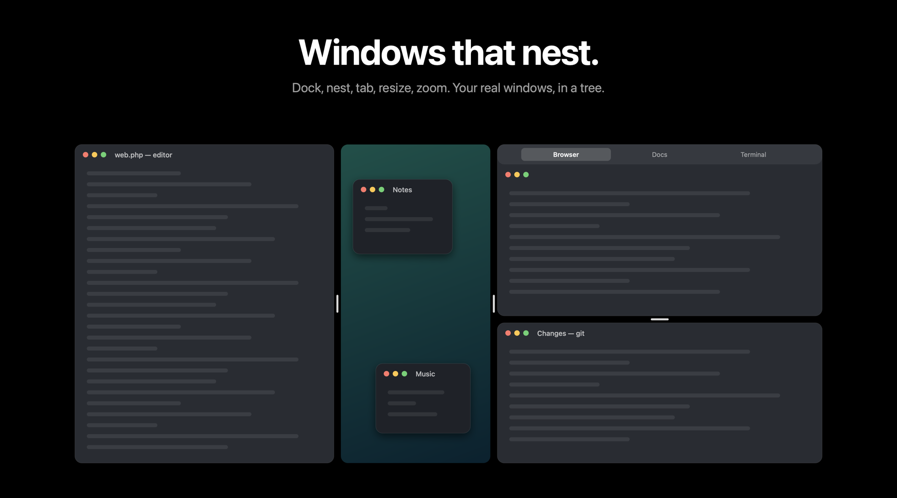

<p align="center">
  
</p>

<h1 align="center">Weaver</h1>

<p align="center">
  A nesting window manager for macOS.<br>
  Dock windows beside each other, nest splits inside splits, zoom into the part you need.
</p>

<p align="center">
  <a href="https://github.com/Voxyfy/weaver/releases/latest/download/Weaver.dmg"><strong>Download for macOS</strong></a> ·
  <a href="https://voxyfy.github.io/weaver/">Website</a> ·
  <a href="docs/DESIGN.md">Design notes</a> ·
  <a href="#türkçe">Türkçe</a>
</p>

<p align="center">
  
  
  
</p>

<p align="center">
  
</p>

---

Weaver arranges the real windows of your Mac apps. Windows docked together share a tree: every split divides
its area along one axis, and any cell can hold another split. The Desktop itself is a cell, so the windows you
leave floating stay visible and shrink to make room. Zoom into any cell and it fills the screen; zoom out and
everything is back where it was.

It is native Swift and AppKit, needs only the Accessibility permission, makes no network connections of its own,
and is MIT licensed.

## Install

1. Download [Weaver.dmg](https://github.com/Voxyfy/weaver/releases/latest/download/Weaver.dmg) and drag Weaver to Applications.
2. Open it. Weaver lives in the menu bar; there is no Dock icon.
3. Allow **Accessibility** when asked (System Settings → Privacy & Security → Accessibility). This is what lets
   Weaver move and resize windows.
4. Optional: allow **Screen Recording** to see a live picture of the window while you drag it. Without it the
   picture is the app's icon.

Requires macOS 14 Sonoma or later, Apple silicon or Intel. The app is signed and notarized and updates itself
through Sparkle.

## Five moves

| | |
|---|---|
| **Dock** | Drag a window by its title bar to a screen edge. It docks there and the Desktop keeps the rest, scaled down. |
| **Nest** | Drop a window on another window's edge to split that cell. Drop it on the Desktop cell's edge to split that. |
| **Tabs** | Drop a window on another's middle and pause half a second: a tab group, with windows from any apps under one strip. |
| **Resize** | Drag the gap between two windows, or a window's own edge. Both neighbours give way. |
| **Zoom** | Double-click a title bar to fill the screen with that window; double-click again to come back. |

Drop a window on the Desktop cell's middle and it takes the Desktop's place; ⌃⌥D brings the Desktop back.
Windows docked outside the current view wait as small chips at the bottom of the screen; one click brings the
view to them. Float a window and it returns to where it was. Quit, and every window is back in its place.

## Keyboard

| Keys | Action |
|---|---|
| ⌃⌥← → | Neighbouring cell left / right |
| ⌃⌥⇧↑ ↓ | Neighbouring cell above / below |
| ⌃⌥↑ / ⌃⌥↓ | Step out a level / step in toward the focused window |
| ⌃⌥↩ | Frame the focused window (again to come back) |
| ⌃⌥Space | Show everything |
| ⌃⌥[ ] | Back / forward through the camera history |
| ⌃⌥⇧1–9 / ⌃⌥1–9 | Save a view / go to a saved view |
| ⌃⌥D | Hide or show the Desktop cell |
| ⌃⌥⌘← → ↑ ↓ | Dock the focused window at that edge |
| ⌃⌥F / ⌃⌥⇧F | Float the focused window / float all |
| Esc | Cancel a drag in progress |

Every shortcut can be re-recorded in Settings. The menu bar pill has back, forward, Desktop, everything and
the Weaver menu; right-click anywhere on it for the menu.

Every action is also a URL, for Raycast, Alfred, Shortcuts or a shell:

```
weaver://dock?side=left        weaver://zoom          weaver://zoom-out       weaver://step-in
weaver://neighbour?dir=right   weaver://everything    weaver://back           weaver://forward
weaver://save-view?n=1         weaver://view?n=1      weaver://desktop        weaver://float
weaver://float-all             weaver://settings
```

## Settings

Space between windows, the screen-edge zone, the tab-group hold time, open at login, apps to leave alone
(their windows float freely and are never docked or scaled), and the shortcuts. Arrangements and saved views are
written to `~/Library/Application Support/Weaver/layout.json` and come back after a relaunch, matched by app and
window title.

## How it works

- **Accessibility API** moves and resizes windows. Coordinates are Quartz, origin at the top-left.
- **Layout tree**: leaves are windows, the Desktop cell, or tab groups; inner nodes split along an axis with one
  ratio per child. Inserting beside a node joins its parent split when the axis matches, otherwise wraps both in
  a new split. Removing a node collapses single-child splits.
- **Layout engine** turns the visible subtree into frames with gaps, plus a seam for every gap and a strip for
  every tab group. Zoom is "lay out this subtree instead of the root".
- **Desktop cell**: floating windows are kept as unit rectangles of the full screen and drawn scaled into
  whatever rectangle the cell has.
- **Overlays** are non-activating panels of Weaver's own: seams (drag to resize), tab strips, tiles for cells
  an app refused to shrink into, parked chips, drag previews and drop highlights.
- **Drags** go through an event tap. After 12 points Weaver waits to see what the app does: a size change is a
  resize and is left alone; a move is taken over. The real window stays put, a picture follows the pointer, and the
  drop docks, groups or places it.
- **Camera moves** ease windows into place over a few frames.

The reasoning behind the behaviours, and what was learned from using TrellisWM, is in [docs/DESIGN.md](docs/DESIGN.md).

## Build from source

```sh
brew install xcodegen
git clone https://github.com/Voxyfy/weaver.git && cd weaver
sh scripts/run-dev.sh
```

`run-dev.sh` generates the Xcode project, builds, signs with your Apple Development certificate, installs to
`/Applications` and launches. Tests: `xcodebuild -project Weaver.xcodeproj -scheme Weaver test`.
Releases: `scripts/release.sh` (Developer ID, notarization, DMG, Sparkle appcast).

Two things contributors run into: the Accessibility permission is tied to the signing identity, so ad-hoc
signatures lose it on every build; and Xcode's debug-dylib packaging is not accepted by that permission on
macOS 27, which is why `ENABLE_DEBUG_DYLIB` is off in `project.yml`.

## Credits

The nesting-and-zoom idea has been in the air for a while; [TrellisWM](https://trelliswm.app) by Dan Fessler
shipped a polished commercial take on it in October 2026. Weaver is an independent, open-source implementation
with its own code and design. Updates by [Sparkle](https://sparkle-project.org) (MIT).

## License

[MIT](LICENSE). © 2026 Batuhan Haymana.

---

## Türkçe

**macOS için iç içe pencere yöneticisi.** Weaver, Mac uygulamalarınızın gerçek pencerelerini düzenler: pencereyi
ekran kenarına sürükleyin kilitlensin, başka bir pencerenin kenarına bırakın o hücre bölünsün, ortasına bırakıp
bekleyin sekme grubu olsun. Masaüstü de bir hücredir; serbest bıraktığınız pencereler kaybolmaz, yer açmak için
küçülür. Başlık çubuğuna çift tıklayınca pencere ekranı kaplar, tekrar çift tıklayınca her şey yerine döner.

**Kurulum:** [Weaver.dmg](https://github.com/Voxyfy/weaver/releases/latest/download/Weaver.dmg) dosyasını indirip
Uygulamalar'a sürükleyin, açın, istenen Erişilebilirlik iznini verin. Weaver menü çubuğunda yaşar. macOS 14 ve
üstü; uygulama imzalı ve noterlidir, kendini Sparkle ile günceller.

**Beş hareket:** kilitle (kenara sürükle), iç içe böl (pencerenin kenarına bırak), sekme (ortasına bırak, bekle),
boyutlandır (boşluğu ya da pencerenin kenarını çek), yakınlaştır (çift tık). Kısayollar yukarıdaki tabloda; her
biri Ayarlar'dan değiştirilebilir ve `weaver://` adresleriyle de çağrılabilir. Düzen yeniden açılışta geri gelir.

Kaynak kodu MIT lisansıyla açıktır; derlemek için `sh scripts/run-dev.sh`.
