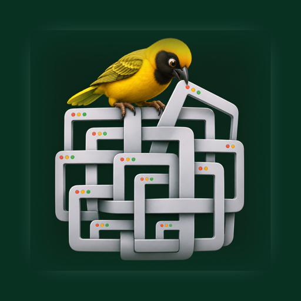

<p align="center">
  
</p>

# Weaver

**A nesting window manager for macOS. Dock windows beside each other, nest splits inside splits, zoom into the part you need. Open source, MIT.**

Weaver arranges the real windows of your other apps. Windows docked together share a tree: each split divides its
area along one axis, and any cell can hold another split. Zoom in on a cell and it fills the screen; zoom out and
everything is back. Drag the gap between two windows to resize both. Float a window and it returns to where it was.

> Early days, but the core is in: the Desktop is a cell that scales its floating windows, drag a window to an
> edge or onto another window's edge to dock it, drop it on a window's middle (pause half a second) for a tab
> group, drag the gap or the window's own edge to resize, double-click a title bar or a tile to zoom. Camera
> history, saved views and a settings window are in too; live drag previews are next.

## Requirements

- macOS 14 Sonoma or later, Apple silicon or Intel
- Accessibility permission (System Settings → Privacy & Security → Accessibility). Weaver uses it to move and
  resize windows and for nothing else.

## Shortcuts

| Keys | Action |
|---|---|
| ⌃⌥← → | Camera to the neighbouring cell left / right |
| ⌃⌥⇧↑ ↓ | Camera to the neighbouring cell above / below |
| ⌃⌥↑ / ⌃⌥↓ | Step out a level / step in toward the focused window |
| ⌃⌥↩ | Zoom into the focused window (again to zoom out) |
| ⌃⌥Space | Show everything |
| ⌃⌥[ ] | Back / forward through camera history |
| ⌃⌥⇧1–9 / ⌃⌥1–9 | Save a view / go to a saved view |
| ⌃⌥D | Hide or show the Desktop cell (hidden: docked windows take the whole screen) |
| ⌃⌥⌘← → ↑ ↓ | Dock the focused window at that edge of the screen |
| ⌃⌥F | Float the focused window (it goes back where it was) |
| ⌃⌥⇧F | Float all windows |
| Drag title bar to a screen edge | Dock at that edge; the Desktop keeps the rest, scaled down |
| Drag onto a window's edge band | Split that cell |
| Drag onto the Desktop cell's edge | Split the Desktop cell |
| Drag onto the Desktop cell's middle, pause | The window takes the Desktop's place (⌃⌥D brings the Desktop back) |
| Drag onto a window's middle, pause | Tab group; click a tab to switch, × to float it out |
| Drag the gap, or a window's own edge | Resize both neighbours |
| Double-click a title bar or a tile | Zoom in or out |

The menu bar pill has back, forward, Desktop, everything and the Weaver menu (right-click anywhere on it for
the menu). Settings (⌘, from the menu): gap between windows, screen edge zone, tab-group hold time, open at
login, apps to leave alone, and every shortcut above can be re-recorded.

Arrangements and saved views come back after a relaunch: Weaver writes each screen's tree to
`~/Library/Application Support/Weaver/layout.json` and matches windows by app and title on the next start.

The same actions are URLs, for Raycast, Alfred, Shortcuts or a shell: `weaver://dock?side=left`, `weaver://zoom`,
`weaver://zoom-out`, `weaver://step-in`, `weaver://neighbour?dir=right`, `weaver://everything`, `weaver://back`,
`weaver://forward`, `weaver://save-view?n=1`, `weaver://view?n=1`, `weaver://desktop`, `weaver://float`,
`weaver://float-all`, `weaver://settings`.

## How it works

- **Accessibility API** moves and resizes windows (`AXWindow`). Coordinates are Quartz, origin top-left.
- **Layout tree** (`LayoutNode`): leaves are windows, inner nodes split along an axis with one ratio per child.
  Inserting beside a node either joins its parent split (same axis) or wraps both in a new split.
- **Layout engine** turns the visible subtree into frames with gaps, and a `Seam` for every gap.
- **Seam panels** are invisible, non-activating windows over the gaps; dragging one moves the ratio and re-applies.
- **Zoom** is just "lay out this subtree instead of the root".
- **Desktop cell**: floating windows are kept as unit rectangles of the full screen and drawn scaled into
  whatever rectangle the Desktop cell has; when nothing is floating the cell hides.
- **Tiles** cover a cell whose app refused to shrink that far (apps clamp to a minimum size).
- **Tab groups** are a leaf holding several windows at the same frame; the strip above is Weaver's own panel.
- **Drags** go through an event tap: after 12 pt the real window stays, a picture follows the pointer, and the
  drop docks, groups or places it. With Screen Recording allowed the picture is a live snapshot; without it,
  the app's icon.

## Build

```sh
brew install xcodegen
git clone https://github.com/Voxyfy/weaver.git && cd weaver
sh scripts/run-dev.sh     # generates the project, builds, signs, installs to /Applications and launches
```

Tests: `xcodebuild -project Weaver.xcodeproj -scheme Weaver test`.

A note for contributors: Xcode's debug-dylib packaging (a stub executable plus `Weaver.debug.dylib`) is not
accepted by the Accessibility permission on macOS 27; `ENABLE_DEBUG_DYLIB` is off in `project.yml` for that reason.

## Icon

A weaver bird tying a strand into its nest, in the 3D mascot style of the other Voxyfy apps. Source art in
`design/icon-source.png`, Icon Composer bundle in `Weaver/Resources/AppIcon.icon`.

## Credits

The nesting-and-zoom idea is in the air; [TrellisWM](https://trelliswm.app) by Dan Fessler shipped a polished
commercial take on it in October 2026. Weaver is an independent, open-source implementation with its own code and
design, started because people asked for a hackable one.

## License

MIT, see [LICENSE](LICENSE).

---

## Türkçe

**macOS için iç içe pencere yöneticisi.** Pencereleri yan yana kilitleyin, bölmelerin içine bölme açın, ihtiyacınız
olan kısma yaklaşın. Açık kaynak, MIT.

Weaver diğer uygulamaların gerçek pencerelerini düzenler. Birlikte kilitlenen pencereler bir ağaç paylaşır; her
bölme alanını bir eksende ikiye ayırır, her hücre yeni bir bölme taşıyabilir. Bir hücreye zoom yapınca ekranı
kaplar; dışarı çıkınca her şey yerine döner. İki pencere arasındaki boşluğu sürükleyince ikisi birden boyutlanır.
Serbest bıraktığınız pencere eski yerine gider.

Gereksinim: macOS 14 ve üstü, Erişilebilirlik izni. Kısayollar yukarıdaki tabloda; aynı işler `weaver://` adresleriyle
de yapılır. Henüz erken sürüm: sürükleyerek kilitleme, sekme grupları ve kayıtlı görünümler sırada.
